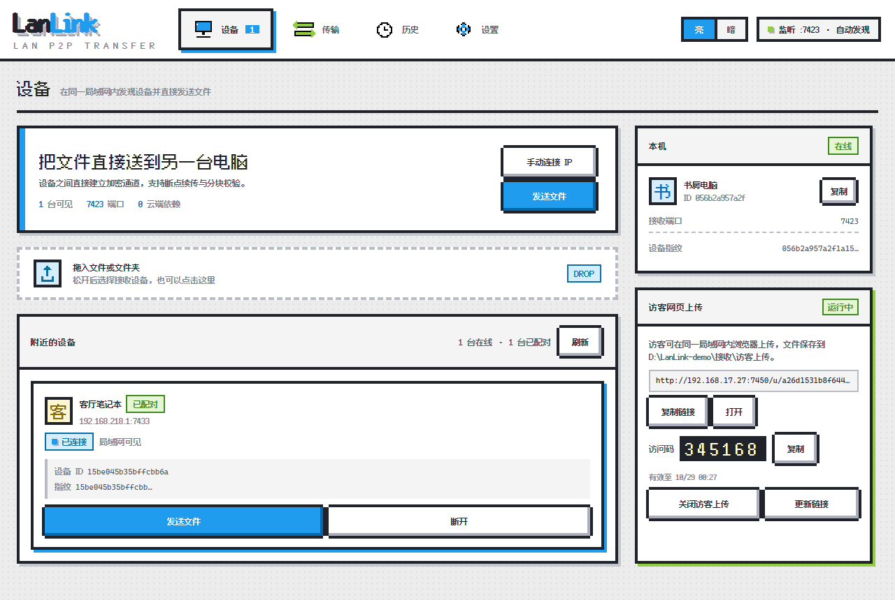
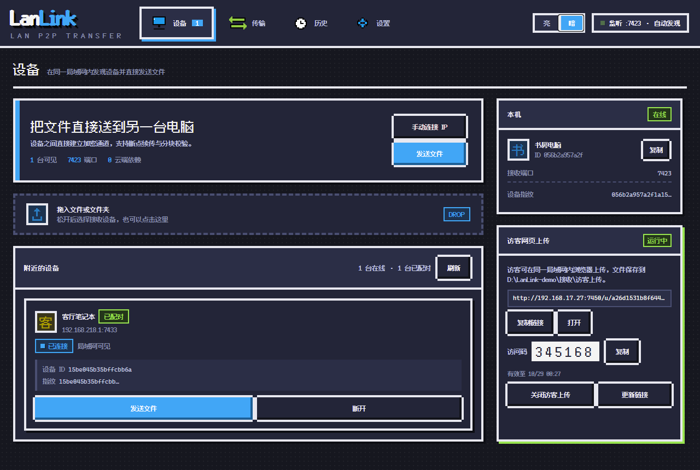
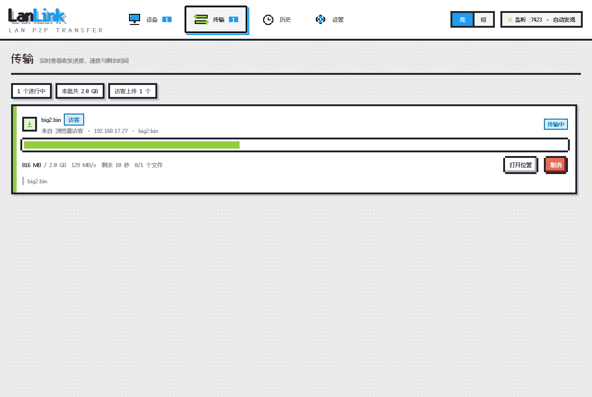
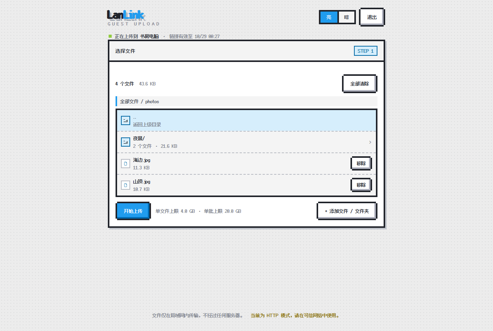
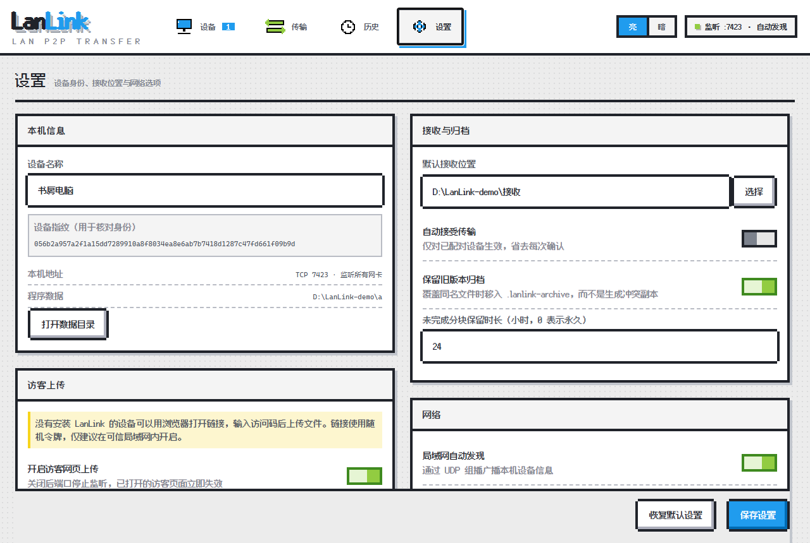

<p align="center">
  
</p>

<h1 align="center">LanLink</h1>

<p align="center">纯局域网文件直传 · 端到端加密 · 不经过云端 · 无需账号</p>

<p align="center">
  
  
  
  
  
  
</p>

<p align="center">
  <a href="docs/USAGE.md">完整使用文档</a> ·
  <a href="#-快速开始">快速开始</a> ·
  <a href="#-安全模型">安全模型</a> ·
  <a href="#-常见问题">常见问题</a>
</p>

---

LanLink 是一个 **局域网内点对点文件直传工具**：两台电脑都装上就能走端到端加密通道互传文件；对方没装软件时，也能用浏览器打开邀请链接、输入 6 位访问码，把文件直接传到你机器上。

文件不会经过任何云端服务器，没有账号体系，也没有遥测和联网请求。桌面端基于 Electron，核心是一个 **零第三方运行时依赖** 的 Node.js 服务。

## ✨ 特性

- **端到端加密**：Ed25519 长期身份 + X25519 临时密钥协商 + HKDF-SHA256 派生 + AES-256-GCM 逐帧加密认证，配对时用 6 位 SAS 验证码防中间人。
- **局域网直连**：TCP 点对点传输，千兆链路实测 100–113 MB/s；不走公网、不经过中继。
- **断点续传**：4 MiB 分块 + 每块 SHA-256 校验，断线后重新发送相同文件只补缺失分块。
- **文件夹原样保留**：目录结构、空文件都能还原；同名文件支持「自动跳过 / 旧版本归档 / 冲突副本」三种策略。
- **访客零安装**：对方只需浏览器，随机令牌 + 6 位访问码 + HttpOnly Cookie，用完即关或一键轮换链接。
- **自动发现**：UDP 组播广播附近设备；组播被禁、跨网段或开了 AP 隔离时，可以手动输入 IP 连接。
- **像素风界面**：8bit 风格 UI（NES.css + 中文像素字体 + 像素图标），支持亮色 / 暗色主题切换并记住选择。
- **轻量干净**：运行时无第三方依赖，不写注册表、不装服务、不引入常驻后台。
- **即开即用**：提供 Windows 免安装绿色包，解压即用，不需要安装程序。

## 📸 界面

| 设备页（亮色） | 设备页（暗色） |
| :---: | :---: |
|  |  |

| 传输进度 | 访客网页上传 |
| :---: | :---: |
|  |  |

<details>
<summary>设置页</summary>



</details>

## 🚀 快速开始

**环境要求**：Node.js ≥ 20（推荐 22/24），Windows 10/11、macOS 或 Linux（当前主要在 Windows 上验证）。

```bash
git clone https://github.com/ASen37/LanLink.git
cd LanLink
npm install
npm start
```

启动后会打开桌面窗口，同时在本机开始监听：

| 用途 | 默认端口 | 监听地址 |
| --- | --- | --- |
| 桌面界面（HTTP + SSE） | 随机 | `127.0.0.1` |
| 设备间传输（TCP） | 7411 | `0.0.0.0` |
| 局域网发现（UDP 组播） | 7412 | `0.0.0.0` |
| 访客上传（HTTP） | 7420 | 仅在开启访客上传时监听 |

> 首次运行 Windows 防火墙弹窗时，请勾选「专用网络」并允许访问，否则其他设备连不上。

### 本机双实例调试

```bash
npm run dev:a   # http://127.0.0.1:7421
npm run dev:b   # http://127.0.0.1:7431
```

两个实例共用 UDP 发现端口，数据目录分别为 `dev/node-a`、`dev/node-b`，并开启自动信任（仅用于本地联调）。

## 📦 打包（Windows）

```bash
npm install
npm run dist:win
```

输出在 `bin/LanLink-win32-x64/`，双击 `LanLink.exe` 即可运行：

- **免安装绿色版**：不写注册表、没有安装向导，整个文件夹拷贝到任意位置都能用
- 不能只拷 `LanLink.exe`，它依赖同目录的 Electron 运行库和 `resources/app.asar`
- 当前未做代码签名，首次运行可能出现 SmartScreen「未知发布者」提示
- 若打包时卡在下载 Electron，可设置 `ELECTRON_MIRROR` 或使用 `--electron-zip-dir` 指向本地包

## 🔀 两种传输方式

| | 设备互传 | 访客网页上传 |
| --- | --- | --- |
| 对方需要安装 | 需要 | 不需要，浏览器即可 |
| 传输安全 | 端到端加密（AES-256-GCM） | HTTP 明文 + 令牌 + 6 位访问码 |
| 适合场景 | 长期互传、大文件、文件夹 | 手机、临时电脑、访客一次性上传 |
| 是否需要配对 | 首次需核对验证码 | 输入访问码 |

## 📖 使用流程

1. **发现设备**：两台电脑都打开 LanLink，设备页会自动列出附近设备；发现不了就用手动连接 IP。
2. **首次配对**：点「配对」，双方屏幕显示相同的 6 位验证码，核对一致后接受，之后无需再确认。
3. **发送文件**：点「发送文件」选择文件/文件夹，或直接拖进虚线区域；接收方确认后开始传输。
4. **查看进度**：传输页显示总进度、速度、剩余时间，可随时取消；完成后可直接打开所在位置。
5. **访客上传**：设备页开启「访客网页上传」，把邀请链接 + 访问码发给对方，对方在浏览器里选文件即可。

> 更完整的说明（续传规则、归档策略、访客限制、端口与防火墙、常见问题）见 [docs/USAGE.md](docs/USAGE.md)。

## 🔐 安全模型

| 环节 | 做法 |
| --- | --- |
| 设备身份 | 每台设备生成 Ed25519 长期密钥，设备 ID 由公钥 SHA-256 前 20 字节派生 |
| 会话密钥 | 每次连接生成 X25519 临时密钥，ECDH 协商后经 HKDF-SHA256 派生双向密钥 |
| 数据加密 | 控制消息与文件分块全部 AES-256-GCM 加密并认证，序列号防重放 |
| 中间人防护 | 首次配对双方显示同一 6 位 SAS 验证码，人工核对 |
| 完整性 | 每 4 MiB 分块单独 SHA-256 校验，失败自动重传（最多 4 次） |
| 本地数据 | 身份、信任列表、设置、历史保存在用户数据目录，私钥不外发 |

访客模式是 **HTTP 明文**，仅适合可信局域网：它依靠随机令牌、6 位访问码、登录限速、路径约束和会话过期来限制访问。需要强保密时请使用双方都安装 LanLink 的端到端模式。

## 🧱 项目结构

```
lanlink/
├─ build/                应用图标（icon.png / icon.ico，打包用）
├─ src/
│  ├─ main.js            Electron 主进程（窗口、多开、系统对话框）
│  ├─ preload.js         渲染进程 IPC 桥
│  ├─ server.js          本机 HTTP + SSE 服务与静态资源
│  ├─ core/
│  │  ├─ manager.js      设备 / 会话 / 信任 / 任务编排
│  │  ├─ channel.js      加密通道、分帧与心跳
│  │  ├─ crypto.js       X25519 / HKDF / AES-GCM / SAS
│  │  ├─ transfer.js     分块传输、续传、归档、校验
│  │  ├─ discovery.js    UDP 组播发现
│  │  ├─ guest.js        访客上传服务
│  │  ├─ identity.js     设备身份与指纹
│  │  └─ util.js         通用工具
│  └─ ui/                桌面界面与访客页（原生 JS + NES.css）
│     └─ vendor/         框架样式、像素字体、字标与导航图标
├─ test/                 集成测试 / 访客测试 / 性能基准
├─ bin/                  打包输出（git 忽略）
└─ docs/                 使用文档与截图
```

技术栈：Electron 45 + Node.js 24 内置模块（`node:net`、`node:crypto`、`node:http`），前端为原生 HTML/CSS/JS，无打包构建步骤。

## 🧪 测试

```bash
npm test             # 集成测试：加密、配对、文件夹、归档、冲突、续传、抓包校验
npm run test:guest   # 访客上传：登录、分块、配额、续传、轮换、关闭端口
npm run bench        # 本机回环性能基准（两个独立服务进程）
```

## ⚠️ 已知限制

- 访客模式为 HTTP 明文，仅限可信局域网使用，不要在公共 Wi-Fi 长期开启。
- 目前没有二维码、手机 App、开机自启、自动更新和安装程序；桌面版可用 `npm start` 运行源码，或使用 `npm run dist:win` 生成免安装绿色包。
- 组播发现不跨路由器；跨网段、跨 VLAN 或开启 AP 隔离时请手动连接 IP。
- 界面暂无「解除配对」入口：需要在设备卡片上点「断开」，或手工编辑数据目录里的 `trusted.json`。

## ❓ 常见问题

互相看不到设备、端口被占用、访客链接失效、传输中断后怎么续传、如何重置身份……都在 [使用文档 · 常见问题](docs/USAGE.md#9-常见问题) 里。

## 📄 许可证

本项目基于 [MIT License](LICENSE) 开源，Copyright © 2026 ASen37。

---

<p align="center"><sub>LanLink · 文件只在局域网里走，不经过任何服务器。</sub></p>
